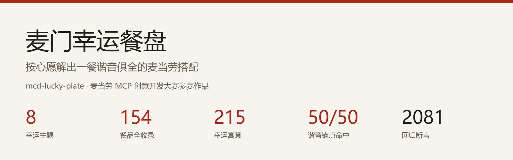
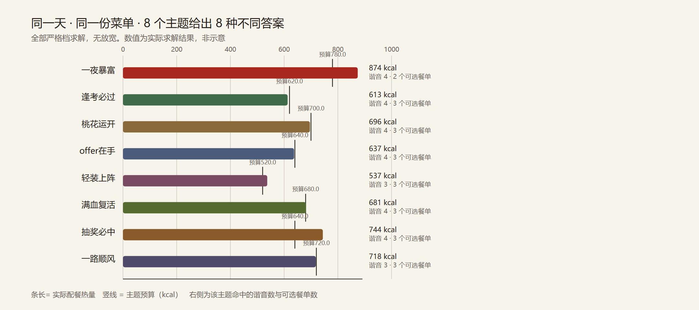
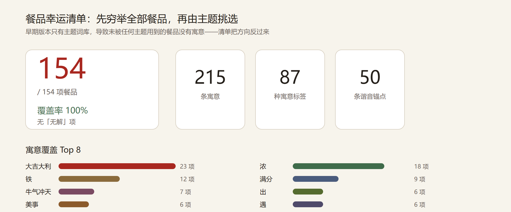
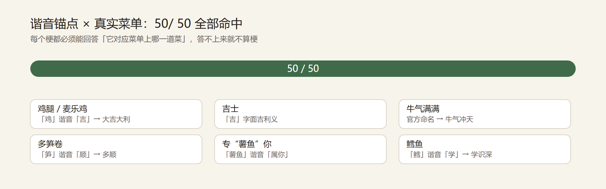
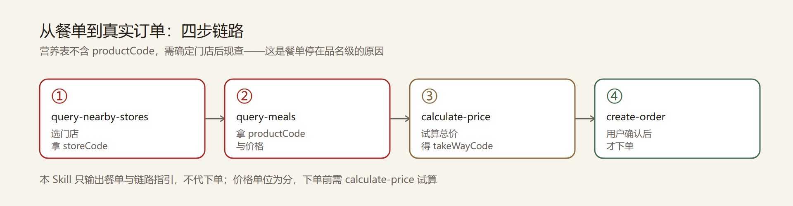

<div align="center">



# 麦门幸运餐盘

**按心愿解出一餐谐音俱全的麦当劳搭配**

[](https://www.python.org/)
[](#安装)
[](MCP_INTEGRATION.md)

[快速开始](#快速开始) · [餐品幸运清单](#餐品幸运清单) · [下单链路](#从餐单到下单) · [诚实边界](#诚实边界) · [贡献](CONTRIBUTING.md)

</div>

---

## 这是什么

你今天想讨个吉利——考试前、面试前、抽奖前、搬家前。

市面上的「幸运餐单」几乎都是编的：查不到菜单、热量随口写、谐音牵强。
本项目**反过来做**：先锁定麦当劳 MCP 返回的 **154 项真实在售餐品**，
再在这些菜名上找谐音。

- 「**麦满分**」确实是官方命名 → 所以「考试满分」的梗不是硬凑
- 「**板烧鸡腿堡**」确实在售 → 所以「鸡→吉」的谐音有实物支撑
- 每个梗都能回答「它对应菜单上哪一道菜」，**答不上来就不算梗**

| 154 | 215 | 50/50 |
|---:|---:|---:|
| 餐品**全部**收录寓意 | 条幸运寓意 | 谐音锚点命中 |

---

## 快速开始

**零第三方依赖**，只需 Python 3.10+。**离线模式无需 Token、无需联网**：

```bash
git clone https://github.com/imgww/mcd-lucky-plate.git
cd mcd-lucky-plate

# 看 8 个主题分别解出什么（无需 Token）
python src/lucky_plate.py --compare --offline samples/nutrition-foods.raw.json

# 看「一夜暴富」主题的完整餐单
python src/lucky_plate.py --theme 一夜暴富 --offline samples/nutrition-foods.raw.json
```

真实输出：

```text
  【一夜暴富 · jackpot】今晚吃这一顿，明天对账
  预算 780 kcal ±18%   钠上限 2106 mg   甜品放开
  候选池 20 / 154 项（只含能命中谐音锚点的餐品）
  谐音锚点 7 / 7 命中
────────────────────────────────────────────────────────────────
  餐单 1   谐音命中 4 个   874 kcal   55g 蛋白
     · 双层原味板烧鸡腿麦满分  [主食]  355 kcal  钠 984 mg  ← 双层 / 鸡腿 / 麦满分
     · 烟肉蛋麦满分            [主食]  260 kcal  钠 483 mg  ← 麦满分
     · 原味板烧鸡腿麦满分      [主食]  246 kcal  钠 611 mg  ← 鸡腿 / 麦满分
     · 浓缩咖啡                [饮品]   13 kcal  钠   0 mg  ← 浓缩
     合计 874 kcal  蛋白 55.0 g  脂肪 36.0 g  碳水 78.0 g  钠 2078 mg
       梗：双层 → 双赢、双份，寓意加倍进账
       梗：鸡腿 → 「鸡」谐音「吉」，大吉大利；「利」字还额外应了暴富
       梗：麦满分 → 考试满分；分数满则财源顺
       梗：浓缩咖啡 → 「浓缩财富」，一天把本事熬浓

  饭后不洗碗，碗会自己变干净（大概）。
```

需要实时数据时再配 Token：

```bash
export MCD_MCP_TOKEN="你的Token"        # Windows: $env:MCD_MCP_TOKEN="..."
python src/lucky_plate.py --list-tools   # 应输出 35 个工具
python src/lucky_plate.py --theme exam
```

完整配置见 [`references/setup-guide.md`](references/setup-guide.md)。

---

## 8 个幸运主题



**同一天、同一份菜单，8 个主题给出 8 种不同答案**——这是本 Skill 的核心主张。
全部严格档求解，零放宽。

| 主题 | key | 一句话 | 热量 | 甜品 |
|---|---|---|---:|---|
| 一夜暴富 | `jackpot` | 今晚吃这一顿，明天对账 | 780 | 开 |
| 逢考必过 | `exam` | 考场外先吃饱，进场不慌 | 620 | 开 |
| 桃花运开 | `lovestruck` | 一个人吃饭，也要甜到底 | 700 | 开（加权最高） |
| offer在手 | `interview` | 面试午餐，稳住别出错 | 640 | **关** |
| 轻装上阵 | `no-carb` | 吃到撑，但热量不背锅 | 520 | **关** |
| 满血复活 | `heal` | 昨天崩了，今天重开 | 680 | 开 |
| 抽奖必中 | `win-lottery` | 不用抽奖，这份餐自己就是奖 | 640 | 开 |
| 一路顺风 | `travel` | 出发前吃好，路上别堵 | 720 | 开（低权） |

### 主题差异作用在四处

缺一层，所有主题就会收敛成同一批「万金油」餐品——**这是实测出来的，不是设计出来的**：

| # | 作用点 | 缺了会怎样 |
|---|---|---|
| 1 | 锚点集合 | 所有主题推同一批通用餐品 |
| 2 | 硬约束（热量 / 钠 / 容差） | 主题间营养数字完全一致 |
| 3 | 甜品开关 | 「面试」「轻装上阵」会拿到甜品餐，叙事崩塌 |
| 4 | 打分权重（谐音占 0.46，最高） | 退化成纯营养推荐，梗变装饰 |

---

## 餐品幸运清单



早期版本只有「主题词库」——由主题定义关键词、再反查餐品。
那个方向有个**结构性缺陷**：只有被某个主题用到的约 50 项餐品才有寓意，
其余一百多项白白浪费。用户问「我这杯燕麦奶有什么寓意」时答不上来。

本清单把方向反过来：**先穷举全部餐品逐项标注寓意，主题再从清单里挑**。

```bash
# 看完整清单（按品类分组）
python src/lucky_plate.py --menu-luck --offline samples/nutrition-foods.raw.json

# 反查某个寓意对应哪些餐品
python src/lucky_plate.py --menu-luck 大吉大利 --offline samples/nutrition-foods.raw.json
# → 23 项餐品
```

| 类型 | 梗 | 落到哪道菜 |
|---|---|---|
| 谐音 | 鸡腿 → **大吉大利** | 板烧鸡腿堡（菜单中 5 项含「鸡腿」） |
| 谐音 | 鳕鱼 → **学识深** | 双层深海鳕鱼堡 |
| 谐音 | 多笋 → **多顺** | 酥酥多笋卷 |
| 谐音 | 麦香鱼 → **年年有余** | 麦香鱼 |
| 字面 | 吉士 → **吉利** | 吉士汉堡包 |
| 官方 | 牛气满满 → **牛气冲天** | 牛气满满 |
| 官方 | 专“薯鱼”你 → **专属于你** | 专“薯鱼”你 |
| 官方 | “苹板”支撑Pro → **平安** | “苹板”支撑Pro |

> 菜单里有三个品名是麦当劳官方自带的营销梗，谐音天然工整、可靠性最高。

清单全文：[`docs/餐品幸运清单.md`](docs/餐品幸运清单.md) ·
逐条数据：[`docs/餐品幸运清单.csv`](docs/餐品幸运清单.csv)

---

## 谐音锚点必须落在真实菜单上



这是本 Skill 最硬的一条门禁：

```bash
python src/lucky_plate.py --anchors --offline samples/nutrition-foods.raw.json
```

逐条输出每个锚点命中几项、对应哪道菜、梗的解释与溯源，**未命中的会被显式标出**。

**开发过程中确实抓到过 3 个失效锚点**——初版词库写了「鲈」「扭蛋」「开心」，
菜单里根本没有。这是「编造餐品」的真实风险。现已改为精确子串匹配，
不退回模糊匹配、不编造餐品名。

同类问题还有**锚点过宽**：`鱼` 会命中营销梗名「专“薯鱼”你」，
引擎一度把它当主菜推给用户——**测试全绿也发现不了，只有看实际输出才能发现**。
现已收窄为 `麦香鱼`。

---

## 从餐单到下单



本 Skill 关心怎么把餐单变成订单，但**自己不产生订单**。

### 为什么停在品名级

| 事实 | 后果 |
|---|---|
| `list-nutrition-foods` 只返回营养成分，**不含 `productCode`** | 餐单只能到品名级 |
| `productCode` 只能由 `query-meals` 取得，且**需先有 `storeCode`** | 拿编码必然引入门店依赖 |

若为拿编码而接入门店链路，餐单就无法离线复现——任何人 clone 后配自己的
Token 都跑不通。因此本 Skill 产出**品名级**方案并标注 `needs_code_lookup`，
同时给出完整链路指引：

```bash
python src/lucky_plate.py --order-help      # 打印完整链路与参数规则
```

### 参数陷阱（实测 schema 校准）

| 场景 | `orderType` | `beType` | `beCode` | 其他必传 |
|---|---|---|---|---|
| 到店自取 | 1 | 1 | **不传** | `takeWayCode` |
| 得来速（车道取餐） | 1 | 5 | **必传** | `takeWayCode` |
| 麦乐送到家 | 2 | 2 | **必传** | `addressId` |
| 企业团餐 | 2 | 6 | **必传** | `gmServiceCode` |

- `storeCode` / `orderType` / `beType` **任何场景都必填**
- **价格单位是分**，展示需 ÷100
- `takeWayCode` 来自 `calculate-price` 的 `takeWayList[].code`，不是自己编
- 套餐子项走 `items[].roundList`，与单点结构不同

详见 [`references/ordering-playbook.md`](references/ordering-playbook.md)。

---

## 命令一览

```bash
# 主题
python src/lucky_plate.py --themes                      # 列出全部主题
python src/lucky_plate.py --theme 一夜暴富                # 指定主题出餐单
python src/lucky_plate.py --compare                      # 8 主题对比
python src/lucky_plate.py --theme exam --json            # 机器可读输出

# 清单与核验
python src/lucky_plate.py --menu-luck                    # 餐品幸运清单
python src/lucky_plate.py --menu-luck 大吉大利            # 反查某寓意
python src/lucky_plate.py --anchors                      # 锚点逐条核验

# 下单与自检
python src/lucky_plate.py --order-help                   # 下单链路指引
python src/lucky_plate.py --list-tools                   # MCP 连通自检
python scripts/check_environment.py                      # 环境就绪检查

# 重建产物
python scripts/export_menu_luck.py# 重建清单文档
python docs/make_figs.py                                 # 重建配图
python tests/test_lucky.py                               # 2081 项断言
```

加 `--offline samples/nutrition-foods.raw.json` 即为离线模式。

---

## 诚实边界

工具不静默违背自己设的约束，也不用假数据顶替真实输出。

### 1. 谐音只是文案玩法，不承诺效果

所有谐音与吉祥话是**文案玩法**，**不构成任何运势或效果承诺**。
输出尾部固定打印该声明。

### 2. 一夜暴富是钠最高的主题，这是数据决定的

初版按通用线给到钠上限 1404mg，结果无解。写校准脚本扫过 600–780 kcal
共 10 档预算，**无一能在严格钠线下解出**——该主题锚点全指向高蛋白主食，
实测单品钠 728–1373mg，两件必然超钠。

处理方式：**显式放宽钠上限并写进 `provenance`**，而不是让引擎悄悄放宽。
诚实代价：它是本 Skill 钠含量最高的主题。想控钠请选「轻装上阵」。

```bash
python scripts/calibrate_jackpot.py    # 可复现上述结论
```

### 3. 谐音锚点过宽会让营销梗名顶包

`鱼` 命中过「专“薯鱼”你」——**测试全绿也发现不了**。
判断标准：梗说的是「牛堡」就不该让牛奶来顶，说的是「鱼」就不该让营销名来顶。

### 4. 你设定的谐音下限不会被自动放宽

`--min-hits 99` 会**如实返回无解**并告诉你当前菜单只命中几个梗，
而不是一路降到 1 个、假装满足了要求。这条有回归断言锁死。

### 5. 餐单不保证当前门店在售

营养表是「常见餐品」非全量菜单，不含区域限定品与门店专属品。

### 6. 不做医疗或营养建议

定位是「均衡搭配 + 谐音玩法」，不含减重承诺与节食方案。

---

## 项目结构

```
mcd-lucky-plate/
├── SKILL.md                    Skill 说明（供 AI 客户端读取）
├── README.md                   本文件
├── MCP_INTEGRATION.md          MCP 集成与下单链路契约
├── skill-dependencies.json     能力声明与降级策略
├── CONTRIBUTING.md             贡献指南
├── src/
│   ├── lucky_plate.py          CLI 入口
│   ├── menu_luck.py            餐品幸运清单（154 项 × 215 条寓意）
│   ├── lucky.py                8 主题 + 50 条谐音词库 + 溯源
│   ├── lucky_engine.py         锚点检索 / 主题感知配平 / 差异化验证
│   ├── nutrition.py            营养取数与字段归一化
│   ├── composer.py             单餐组合穷举与打分
│   └── mcp_client.py           极简 streamable HTTP MCP 客户端（零依赖）
├── scripts/
│   ├── check_environment.py    环境就绪检查（四态路由）
│   ├── export_menu_luck.py     生成清单文档与 CSV
│   ├── calibrate_jackpot.py    约束校准探针
│   └── calibrate_travel.py     约束校准探针
├── docs/
│   ├── 餐品幸运清单.md          154 项餐品的幸运寓意清单
│   ├── 餐品幸运清单.csv         逐条寓意（Excel 双击不乱码）
│   ├── make_figs.py            配图生成（零依赖 SVG + Chrome 截 PNG）
│   ├── sanitize_sample.py      样本入库前脱敏
│   └── figs/                   README 配图
├── references/
│   ├── setup-guide.md          Token 获取与配置指引
│   └── ordering-playbook.md    下单链路参数速查
├── tests/
│   └── test_lucky.py           2081 项断言，离线可跑
└── samples/
    └── nutrition-foods.raw.json 真实 MCP 响应快照（已脱敏公开）
```

代码约 4300 行，**零第三方依赖**（仅 Python 标准库）。

---

## 可验证性

```bash
python tests/test_lucky.py     # 2081 项断言，离线，无需 Token 与网络
```

| 主张 | 怎么证 |
|---|---|
| 谐音不是编的 | 50 条锚点逐条核验在真实菜单中命中 |
| 主题差异是真的 | 8 个主题产出 8 种不同首选（`--compare`） |
| 清单覆盖完整 | 154/154 餐品全覆盖，无「无解」项 |
| 约束没被偷偷违背 | 逐主题逐方案校验热量容差、钠上限、甜品开关 |
| 谐音命中数真实 | `luck_score` 与实数命中数一致性断言 |
| 没有随机性 | 同输入两次运行 md5 一致；打乱菜单顺序输出不变 |
| 妥协被如实报告 | 显式下限不可达时必须返回无解（有断言） |

样本缺失时测试不会崩溃：自动改用合成夹具，把依赖真实菜单的断言显式标记为
**跳过**，不伪装成通过。

---

## 数据来源与合规

唯一数据源是麦当劳 MCP 的 `list-nutrition-foods`：35 个工具里仅有的
「零必填参数 + 纯只读 + 不依赖门店与登录态」工具之一。

这条边界是刻意选的：**任何人 clone 后配自己的 Token 就能完整复现**，
不需要人在特定城市、不需要账户里有券有积分有订单。

仓库内**不含任何真实 Token、密钥或个人信息**。样本入库前经
`docs/sanitize_sample.py` 递归检查禁止字段并脱敏会话追踪标识；
`.gitignore` 拦截 `.env` / `*token*` / `*secret*` / `mcp-config.json`。

---

## 参与项目

麦当劳程序员创意开发大赛（M-CODE）参赛作品，**由参赛者独立开发，非麦当劳官方产品**。

- 输出仅供参考，不构成医疗、营养或其他专业建议
- 餐品信息、价格及供应状态以麦当劳官方渠道实时结果为准
- 谐音与吉祥话仅为文案玩法，不构成任何运势或效果承诺
- 本项目**不产生真实订单、不占用券与积分资产**

完整声明见 [`CONTEST_DECLARATION.md`](CONTEST_DECLARATION.md)。

## 致谢

数据来自[麦当劳 MCP](https://open.mcd.cn/mcp) 开放平台。
本项目仅使用其只读营养查询能力，不接入任何下单、领券、抽奖等写操作工具。

## 许可

代码以 MIT 许可开放。赛事声明与商标归属见 [`CONTEST_DECLARATION.md`](CONTEST_DECLARATION.md)。